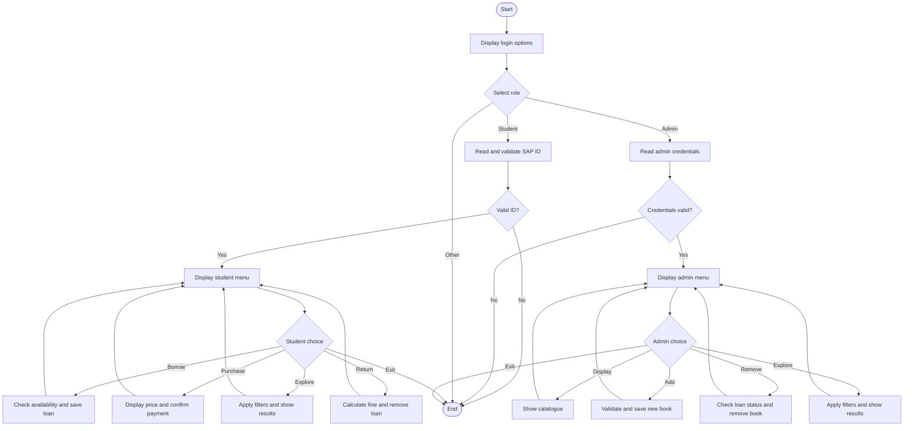

# Library Management System

**A Menu-Driven Library Management Application in C**

## 1. Project Title and Problem Statement

### Project Title
**Library Management System Using C Programming**

### Problem Statement
Managing a library manually can make it difficult to maintain an accurate book catalogue, find books by specific criteria, track borrowed books, and calculate overdue fines. This project develops a console-based Library Management System in C that offers separate student and administrator menus. It stores book and active-loan records in text files and supports book searching, borrowing, returning, purchasing, and catalogue maintenance.

## 2. Team Details

| Detail | Information |
|---|---|
| Team Number | **[Enter team number]** |
| Batch | **B23** |
| Team Member 1 | **Avnindra Punj** |
| Team Member 2 | **Vardh Jain** |
| Team Member 3 | **Abhinav Singh** |

## 3. Objectives and Features of the Program

### Objectives
- Digitize basic library operations through a menu-driven C application.
- Maintain book information including title, ID, price, author, and genre.
- Allow students to find, borrow, purchase, and return books.
- Track active borrowing records using student SAP IDs.
- Calculate late-return fines automatically.
- Allow administrators to manage the catalogue.
- Preserve book and borrowing data in local text files.

### Student Features
1. **Student login:** Enter a positive numeric SAP ID. The current program does not verify the ID against a student database.
2. **Borrow a book:** Enter an available book ID. The system records the SAP ID, book ID, book title, and borrowing date in `loans.txt`.
3. **Purchase a book:** View the book price and confirm whether payment was made. This is a confirmation-based simulation; it does not process an online payment or remove stock.
4. **Explore the library:** Filter books by author, genre, book name, price range, and book ID. Multiple filters can be combined.
5. **Return a book:** Return a book recorded against the current SAP ID, calculate the number of days borrowed and any applicable fine, and remove its active loan record.

### Administrator Features
1. **Admin login:** Authenticate using the username and password stored in `admin.txt`.
2. **Display books:** Show the full book catalogue.
3. **Add a book:** Enter its name, unique ID, price, author, and genre.
4. **Remove a book:** Delete a book from the catalogue only if it is not currently borrowed.
5. **Explore the library:** Use the same catalogue filters as students.

### Search and Validation
- Author, genre, and book-name comparisons ignore letter case and leading/trailing spaces; they are **exact matches after normalization**, not partial-keyword searches.
- Yes/no prompts accept both uppercase and lowercase `Y`/`N`.
- Book IDs and SAP IDs are numeric; invalid numeric input is handled in the corresponding operations.
- Duplicate book IDs are rejected when adding books.
- A borrowed book cannot be borrowed by another student or removed by an administrator.
- The program supports up to **100 books** and **200 active loan records**, as defined by `MAX_BOOKS` and `MAX_LOANS`.

### Fine Calculation

| Days kept | Fine |
|---|---|
| 0–14 days | Rs. 0 |
| 15–21 days | Rs. 10 per day after day 14 |
| 22 days onward | Rs. 70 for days 15–21, plus Rs. 20 for each day after day 21 |

For example, returning a book after 24 days results in `7 × 10 + 3 × 20 = Rs. 130`.

## 4. Algorithm / Pseudocode and Flowchart

### Main Program Algorithm
1. Start the program and display Student Login and Admin Login options.
2. Read the user's role selection.
3. If **Student Login** is selected, read and validate the SAP ID, then display the student menu.
4. If **Admin Login** is selected, read the credentials from the user and compare them with `admin.txt`. Continue only if they match.
5. Read the menu choice and call the corresponding function.
6. For catalogue or loan operations, load the relevant data from `books.txt` or `loans.txt`.
7. Perform validation and the requested operation; save changed records where necessary.
8. Repeat the role-specific menu until Exit is selected.
9. End the program.

### Pseudocode
```text
START
DISPLAY "1. Student Login" and "2. Admin Login"
READ role

IF role = 1 THEN
    READ student SAP ID
    IF SAP ID is invalid THEN STOP
    REPEAT
        DISPLAY student menu
        READ choice
        CASE choice OF
            1: Borrow a book
            2: Purchase a book
            3: Explore library
            4: Return a book and calculate fine
            5: Exit student menu
            OTHERWISE: Display invalid choice
        END CASE
    UNTIL choice = 5

ELSE IF role = 2 THEN
    READ admin username and password
    IF credentials do not match admin.txt THEN STOP
    REPEAT
        DISPLAY admin menu
        READ choice
        CASE choice OF
            1: Display books
            2: Add a book
            3: Remove a book
            4: Explore library
            5: Exit admin menu
            OTHERWISE: Display invalid choice
        END CASE
    UNTIL choice = 5
ELSE
    DISPLAY invalid login option
END IF
STOP
```

### Main Program Flowchart



### Book Search Algorithm
1. Load the catalogue from `books.txt`.
2. Ask whether to filter by author, genre, book name, price range, and book ID.
3. Collect values for enabled filters.
4. Iterate through the books and check **all enabled conditions**.
5. Compare text fields without case sensitivity and ignore leading/trailing whitespace.
6. Print each matching book and the total number of matches, or display a no-results message.

### Book Return Algorithm
1. Load the active loans from `loans.txt`.
2. Read the book ID and locate a loan matching both the current student's SAP ID and book ID.
3. Obtain today's date and calculate the number of days since borrowing.
4. Calculate the fine according to the fine table above.
5. Display the book, dates, days kept, and fine.
6. Remove the active loan record and save `loans.txt`.

## 5. C Programming Concepts Used

The Library Management System applies the following C programming concepts directly in its implementation:

| C concept | Implementation in the program |
|---|---|
| **Structures (`struct`)** | `struct Book` stores book name, ID, price, author and genre; `struct Loan` stores SAP ID, book ID, book name and borrow date. |
| **Arrays** | `books[MAX_BOOKS]` and `loans[MAX_LOANS]` hold up to 100 book records and 200 active loan records. Character arrays store names, genres, credentials and dates. |
| **User-defined functions** | `loadBooks()`, `saveBooks()`, `rentBook()`, `purchaseBook()`, `exploreLibrary()`, `returnBook()`, `addBook()` and `removeBook()` divide the program into reusable operations. |
| **Function parameters and return values** | `rentBook(int sap)` receives a student ID; `findBook(int id)` returns an array index or `-1`; `caseInsensitiveCompare()` returns whether two strings match. |
| **Conditional statements** | `if`, `else if` and `else` check valid inputs, book availability, login credentials, search matches and overdue fine conditions. |
| **`switch` statements** | The student and administrator menus use `switch (choice)` to execute the selected operation. |
| **Loops** | `do-while` repeats menus; `for` scans and shifts records; `while` reads file contents and processes input characters. |
| **File handling** | `fopen()`, `fclose()`, `fgets()`, `fprintf()`, `fscanf()` and `sscanf()` load and save the `books.txt`, `loans.txt` and `admin.txt` records. |
| **String handling** | `strlen()`, `strcmp()`, `strcpy()` and `strcspn()` compare, copy, measure and clean strings. |
| **Character handling** | `tolower()` implements case-insensitive author, genre and title comparisons; `isspace()` ignores surrounding whitespace in those comparisons. |
| **Pointers** | `FILE *fp` accesses files; `struct tm *today` refers to date/time information returned by `localtime()`. |
| **Date and time functions** | `time()`, `localtime()`, `strftime()`, `mktime()` and `difftime()` record borrowing dates and calculate the number of days a book was kept. |
| **Input/output functions** | `printf()` displays menus and results; `scanf()` reads numeric and character choices; `getchar()` clears leftover input; `fgets()` reads complete text lines. |
| **Input validation** | The program checks numeric input, positive SAP IDs, duplicate book IDs, non-negative prices, valid price ranges and existing borrowing records. |
| **Preprocessor directives** | `#include` imports standard libraries; `#define MAX_BOOKS 100` and `#define MAX_LOANS 200` define fixed capacities. |
| **Operators and expressions** | Relational and logical operators combine search filters and validation checks; arithmetic operators calculate overdue fines. |

### Examples from the Source Code

**1. Structures and arrays**
```c
#define MAX_BOOKS 100
#define MAX_LOANS 200

struct Book {
    char name[100];
    int id;
    float price;
    char author[100];
    char genre[50];
};

struct Book books[MAX_BOOKS];
```

**2. Case-insensitive searching**
```c
if (useAuthor && !caseInsensitiveCompare(author, books[i].author))
    match = 0;
if (useGenre && !caseInsensitiveCompare(genre, books[i].genre))
    match = 0;
```
The custom comparison function uses `tolower()` and also ignores leading and trailing whitespace.

**3. Conditional statements and arithmetic for fines**
```c
if (days <= 14)
    fine = 0;
else if (days <= 21)
    fine = (days - 14) * 10;
else
    fine = (7 * 10) + ((days - 21) * 20);
```

**4. File handling**
```c
FILE *fp = fopen("books.txt", "w");
if (fp == NULL) {
    printf("\nError saving books.txt!\n");
    return;
}
/* The program writes each book record using fprintf(). */
fclose(fp);
```

These concepts demonstrate modular programming, record management, persistent text-file storage, menu-driven control flow and basic input validation in C.

## 6. Instructions to Compile and Execute

### Requirements
- GCC or another compatible C compiler.
- Terminal or command prompt.
- The C source file, `books.txt`, and `admin.txt` in the same working directory.
- `loans.txt` is optional initially; it is created when a book is first borrowed.

### Project File Structure
```text
B23_Avip_Library_management_system/
├── library_management_upgraded.c
├── books.txt
├── admin.txt
├── loans.txt                 # Created after the first borrow
└── README.md
```

### Text File Formats

**`books.txt`** — one book per line:
```text
Book Name|Book ID|Price|Author|Genre
```
Example data for testing (do not include a header line in the actual file):
```text
The Alchemist|101|299.00|Paulo Coelho|Fiction
Clean Code|102|599.00|Robert C. Martin|Technology
Atomic Habits|103|450.00|James Clear|Self Help
```

**`admin.txt`** — one `username|password` entry, for example:
```text
admin|123
```
This is a demonstration credential only. The current implementation stores and compares credentials as plain text; do not use a real password.

**`loans.txt`** — generated loan entries:
```text
SAP_ID|Book_ID|Book_Name|YYYY-MM-DD
```

### Compile and Run (macOS / Linux)
Open Terminal in the project directory:
```bash
gcc library_management_upgraded.c -o library_management_upgraded
./library_management_upgraded
```

### Compile and Run (Windows with GCC)
```bash
gcc library_management_upgraded.c -o library_management_upgraded.exe
.\library_management_upgraded.exe
```

**Important:** Run the program from the directory containing the `.txt` files, because the source opens them using relative paths. If `books.txt` is absent, the program prints an error and catalogue-dependent features have no books to process.

## 7. Sample Test Cases with Expected and Actual Outputs

The following cases are derived from the provided C source code. The **Expected Output** column shows the relevant output that the code is designed to print. **Actual Output** is marked *Not yet verified* because no successful execution log for these exact tests was supplied. Run the tests and replace those entries with the observed output before final submission.

Assume the example `books.txt` above and `admin.txt` containing `admin|123`. For independent borrow/return tests, reset `loans.txt` or use an appropriate known state.

| Test case | Input / condition | Expected output (relevant lines) | Actual output |
|---|---|---|---|
| TC01: Student login | Role `1`, SAP ID `590032195` | `Student login successful! Welcome, SAP ID 590032195.` | Not yet verified |
| TC02: Invalid SAP ID | Role `1`, SAP ID `0` | `Invalid SAP ID.` | Not yet verified |
| TC03: Admin login | Role `2`, username `admin`, password `123` | `Admin login successful!` | Not yet verified |
| TC04: Incorrect admin password | Role `2`, username `admin`, wrong password | `Incorrect admin username or password.` | Not yet verified |
| TC05: Case-insensitive genre filter | Student Explore; author `n`, genre `y` → `fiction`, other filters `n` | Result includes `The Alchemist` and `Total books found: 1` | Not yet verified |
| TC06: Case-insensitive author filter | Explore; author `y` → `paulo coelho`, other filters `n` | Result includes `The Alchemist` and `Total books found: 1` | Not yet verified |
| TC07: No matching book | Explore; book name `Unknown Book`, other filters `n` | `Sorry! No books match your search criteria.` | Not yet verified |
| TC08: Successful borrowing | Student SAP `590032195`, Borrow, book ID `101`; no active loan for 101 | `You have successfully borrowed "The Alchemist".` and a borrow date | Not yet verified |
| TC09: Borrow unavailable book | A loan for book `101` already exists; attempt to borrow `101` | `Sorry! This book is already borrowed by another student.` | Not yet verified |
| TC10: Return within 14 days | Existing matching loan for book `101` dated today | `Book returned successfully!` and `Fine: Rs. 0` | Not yet verified |
| TC11: Return after 24 days | Matching loan for book `101` with a borrow date 24 days before return | `Book returned successfully!` and `Fine: Rs. 130` | Not yet verified |
| TC12: Add duplicate book ID | Admin Add Book; ID `101` | `A book with this ID already exists.` | Not yet verified |
| TC13: Remove borrowed book | Admin Remove Book; ID of an actively borrowed book | `This book is currently borrowed. It cannot be removed.` | Not yet verified |
| TC14: Purchase confirmation | Student Purchase, book ID `102`, payment confirmation `Y` | `Purchase successful!` and `Thank you for purchasing "Clean Code".` | Not yet verified |

### Illustrative Console Output: Student Login
```text
========================================
       LIBRARY MANAGEMENT SYSTEM
========================================
1. Student Login
2. Admin Login
Enter your choice: 1

Enter your Student SAP ID: 590032195

Student login successful! Welcome, SAP ID 590032195.

=============== STUDENT MENU ===============
1. Borrow a Book
2. Purchase a Book
3. Explore Library
4. Return a Book
5. Exit
Enter your choice:
```

### Illustrative Console Output: Case-Insensitive Search
```text
========== EXPLORE THE LIBRARY ==========

Do you want to filter by author? (y/n): n
Do you want to filter by genre? (y/n): y
Enter genre: fiction
Do you want to filter by book name? (y/n): n
Do you want to filter by price range? (y/n): n
Do you want to filter by Book ID? (y/n): n

================ SEARCH RESULTS ================
Book Name                 Book ID    Price      Author                    Genre
-------------------------------------------------------------------------------
The Alchemist             101        Rs.299.00  Paulo Coelho              Fiction
-------------------------------------------------------------------------------

Total books found: 1
```

## 8. Limitations and Possible Future Improvements

- **Authentication:** Student login checks only that the SAP ID is positive; administrator credentials are stored as plain text.
- **Purchase:** Payment confirmation is simulated; there is no payment gateway, receipt, or stock reduction.
- **Storage:** Flat text files are used instead of a database, and catalogue/loan arrays have fixed limits.
- **Search:** Text filters use full-field matches after case and edge-whitespace normalization; substring searching is not implemented.
- **Fine collection:** The program calculates and displays fines but does not record fine payments.

Potential enhancements include student registration, password hashing, SQLite database storage, inventory counts, partial-match searching, and a graphical interface.

---

**Submission checklist:** Fill in the team number and all three member names, confirm the batch, include the actual C and data files, run the test cases, and replace the unverified actual-output entries with your recorded results.
